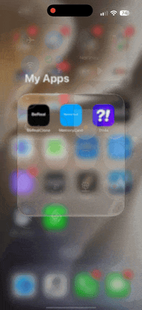

# Project 5 - Trivia

Submitted by: Brian Ribeiro

Trivia is a quiz application that allows users to customize the number, category, difficulty, type, and time limit of their questions.

Time spent: 8 hours spent in total

## Required Features

The following **required** functionality is completed:

- [x] App launches to an Options screen where user can modify the types of questions presented when the game starts. Users should be able to choose:
  - [x] Number of questions
  - [x] Category of questions
  - [x] Difficulty of questions
  - [x] Type of questions (Multiple Choice or True False)
- [x] User can tap a button to start trivia game, this presents questions and answers in a List or Card view.
  - Hint: For Card view visit your FlashCard app. List view is an equivalent to UITableView in UIKit. Much easier to use!
  - [x] Selected choices are marked as user taps their choice (but answered is not presented yet!)
- [x] User can submit choices and is presented with a score on trivia game
 
The following **optional** features are implemented:

- [x] User has answer marked as correct or incorrect after submitting choices (alongside their score).
- [x] Implement a timer that puts pressure on the user! Choose any time that works and auto submit choices after the timer expires. 

## Additional Improvements

Beyond the required and optional features, I added several improvements to make the quiz more complete and user-friendly. Users can select a quiz-wide time limit or choose to play without one. During timed quizzes, a visible countdown appears in the header and turns red when five seconds remain. The quiz also includes answer progress, loading and error messages, a retry option, shuffled answers, and visual checkmarks, X symbols, and colors for answer feedback. After submission, a results screen displays the score and unanswered-question count, with options to review the answers, play again, or return to the settings screen.

## Video Walkthrough

Here's a walkthrough :

## Challenges
Organizing the assignment seemed to be annoying, there are so many small changes added, deciding what to add or leave was the most challenging part.

## License

    Copyright [2026] [Brian Ribeiro]

    Licensed under the Apache License, Version 2.0 (the "License");
    you may not use this file except in compliance with the License.
    You may obtain a copy of the License at

        http://www.apache.org/licenses/LICENSE-2.0

    Unless required by applicable law or agreed to in writing, software
    distributed under the License is distributed on an "AS IS" BASIS,
    WITHOUT WARRANTIES OR CONDITIONS OF ANY KIND, either express or implied.
    See the License for the specific language governing permissions and
    limitations under the License.
